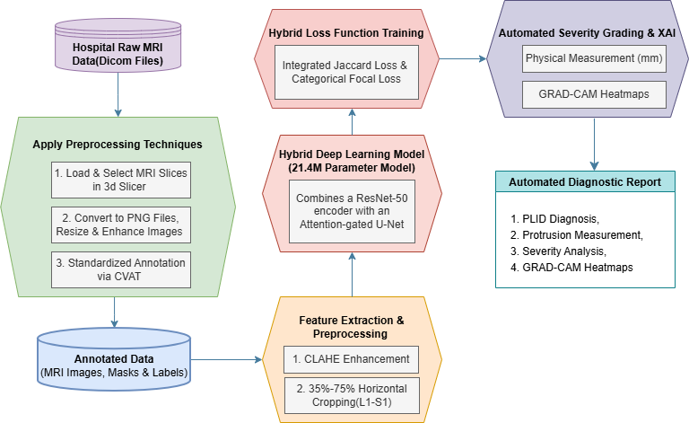
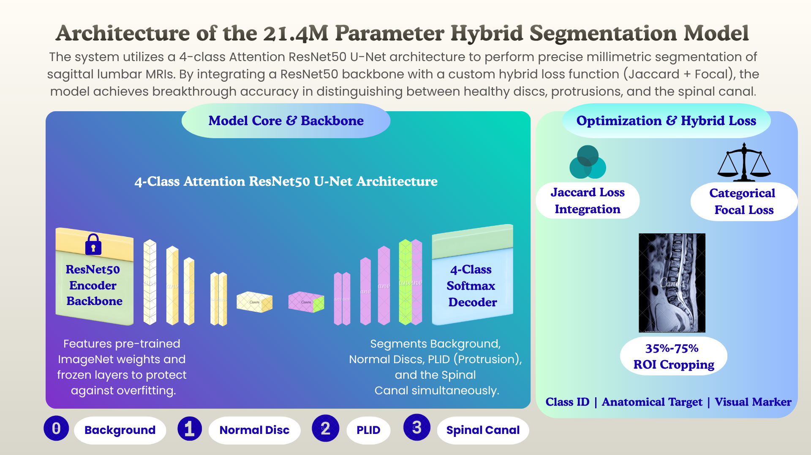
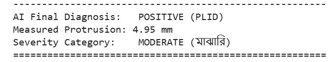

# Explainable Deep Learning for Automated Segmentation, Severity Assessment, and Quantitative Measurement of Prolapsed Lumbar Intervertebral Disc from MRI

**Author:** Tasnim Haque Ankhi  
*Department of Computer Science and Engineering, Jamalpur Science and Technology University, Melandaha, Jamalpur-2012, Bangladesh*  

---

## 📌 Abstract
Prolapsed lumbar intervertebral disc (PLID) is a common spinal disorder for which magnetic resonance imaging (MRI) is routinely used for anatomical and pathological assessment. However, manual identification, segmentation, and grading of disc abnormalities can be time-consuming and do not directly provide quantitative and interpretable model-based outputs. This study developed an explainable deep learning framework for automated PLID assessment from T2-weighted sagittal lumbar MRI. A dataset of 147 patient studies from BLCS Institute & Hospital, Dhaka, Bangladesh was processed using a 21.4-million-parameter Multi-Class Attention ResNet50-U-Net.

---

## 🔄 System Workflow & Architecture

### 1. Overall System Design

### 2. Dataset Collection & Slice Selection
Raw DICOM MRI files from 147 patients were processed using 3D Slicer to select optimal sagittal slices covering the L1-S1 spinal region.

### 3. Pixel-Level Annotation (CVAT)
Manual segmentation was performed to define 4 classes: Background, Normal Intervertebral Disc, PLID, and Spinal Canal.

### 4. Advanced Preprocessing & ROI Cropping
Applied CLAHE contrast enhancement and 35%-75% horizontal region-of-interest (ROI) cropping to eliminate abdominal noise.

### 5. Deep Learning Architecture
The framework employs a **21.4M parameter Multi-Class Attention ResNet50-U-Net** combining a frozen ImageNet ResNet-50 encoder with an attention-gated U-Net decoder.

---

## 📊 Experimental Results & Performance

### Training and Validation Trajectories
The model was trained for 100 epochs using a hybrid loss function combining Jaccard loss and Categorical Focal loss.
- **Training Metrics:** Accuracy: **89.63%** | IoU Score: **0.7611** | Loss: **0.2822**
- **Validation Metrics:** Accuracy: **79.63%** | Validation IoU: **0.5661** | Validation Loss: **0.5050**

### Confusion Matrix Analysis
Class-specific evaluation highlights the model's robustness in segmenting PLID (Precision: 0.77, Recall: 0.78, F1-Score: 0.77) and normal discs.

---

## 📋 Diagnostic Patient Report
Automated generation of detailed patient diagnostic reports containing quantitative measurements, protrusion distances, and severity assessments.

---

## 🩺 Clinical Quantification, Severity Grading & Explainable AI (XAI)
- **Millimetric Measurement:** Segmentation contours are converted into physical measurements using a calibrated scaling factor of **0.15 mm/pixel**.
- **Severity Classification:** Automatically categorizes cases into *Normal/Healthy*, *Mild*, *Moderate*, and *Severe*.
- **Grad-CAM Visualization:** Applied to the `final_conv` layer to provide visual interpretability of image regions associated with PLID predictions.

---

## 👥 Acknowledgments & Contributions
- **Thesis Supervisor:** Dr. Mahmudul Alam  
- **Data Preprocessing Assistance:** Himel Sarder and Md. Tanvir Ahmed  

---

## ⚖️ Ownership & Citation
This repository serves as a permanent public timestamped record of the research conducted at Jamalpur Science and Technology University. All rights reserved by the primary author (*Tasnim Haque Ankhi*).
